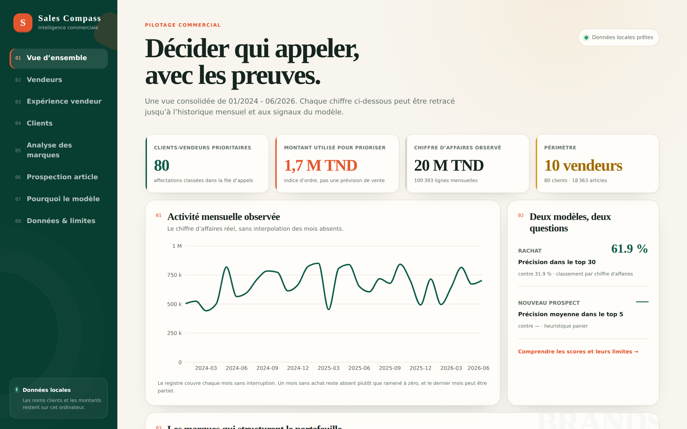
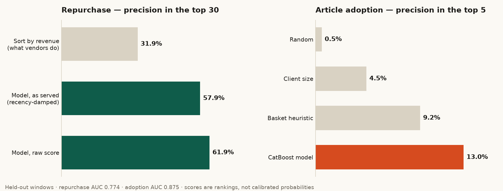
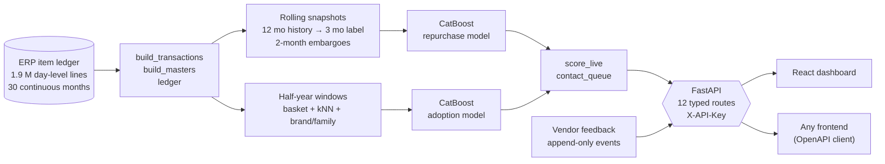
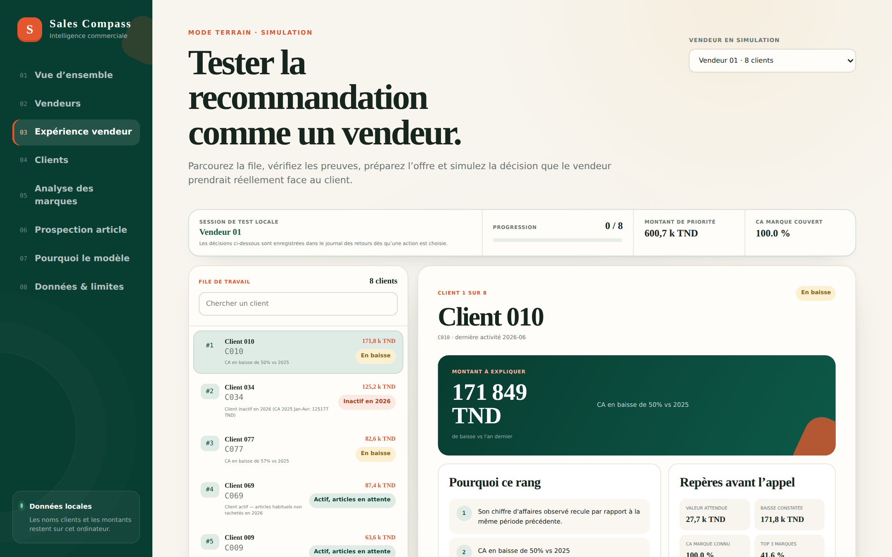
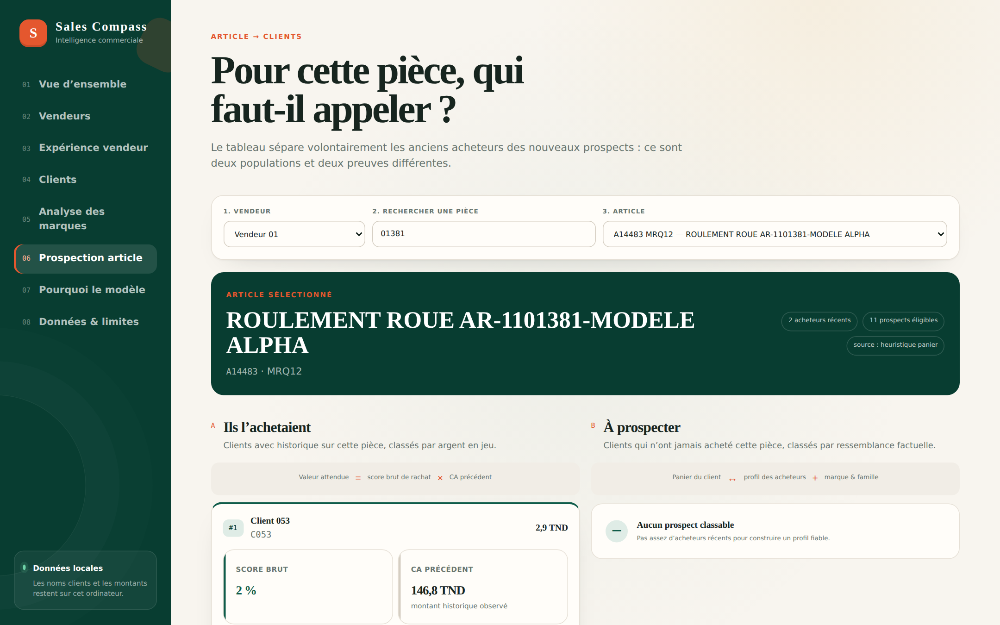
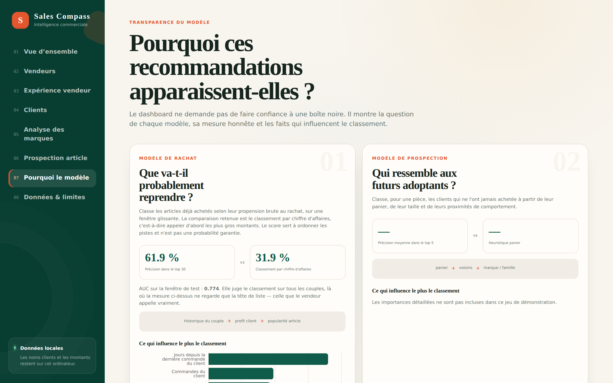

<div align="center">

# Sales Compass

### Tell every sales rep **who to call today — and what to sell them.**

A production-minded recommendation system for an automotive spare-parts distributor:
two CatBoost models trained on 1.9 M ledger lines, served by a typed FastAPI service,
explored through a React dashboard.




<sub>The dashboard running on the committed, fully **anonymised** demo dataset.</sub>

</div>

---

## The problem

A distributor with ~50 sales reps and thousands of garages and shops has a simple daily
question — *which clients should I phone, and for which parts?* — and answers it today by
sorting clients by revenue. That favours the biggest accounts, not the ones that are
**about to reorder** or **slipping away**.

This project answers three questions instead:

1. **Which articles is this client most likely to need next?**
2. **Which clients should I contact today, and for which articles?**
3. **Who are the best prospects for a given article** — including clients who have *never* bought it?

## Results

Both models are evaluated on **time-held-out** windows, against the strongest baseline a rep
would actually use.

<div align="center">

</div>

| Model | Question | Held-out AUC | Headline metric | Baseline |
| --- | --- | --- | --- | --- |
| **Repurchase** (v4, rolling snapshots) | Will a client re-buy an article they already bought? | **0.774** — stable at 0.773–0.775 across 4 test months | precision@30 **61.9 %** raw · 57.9 % as served | 31.9 % (sort by revenue) |
| **Article adoption** (prospect) | Who would buy an article they have *never* bought? | **0.875** | precision@5 **13.0 %** | 9.2 % basket heuristic · 0.5 % random |

> **Scores are rankings, not probabilities.** Neither model is calibrated, and the API
> says so in its contract (`score_is_calibrated: false`). The repurchase AUC is also *not*
> comparable to the v1 model's 0.762 — different horizon and label definition — and
> `reports/rolling_metrics.json` carries that warning in a machine-readable field.

## How it works



**Design decisions worth reading about**

- **No temporal leakage.** Snapshots are chronological, with a two-month *embargo* on both split
  boundaries so a label window can never overlap a feature window.
- **Honest labels.** A January–May-only extract made repurchase look like 19.8 % when the
  true full-year rate was 31.0 % — label noise no amount of tuning could fix
  ([reports/blind_spot.md](reports/blind_spot.md)). Switching to a day-level ledger removed it.
- **Recency damping.** The raw model over-recommends clients served days ago. The served
  ranking demotes them, and the docs report precision for *what is actually served*
  (57.9 %), not just the flattering raw score.
- **The API fails closed.** Serving real data without authentication is refused at startup
  unless explicitly opted into; `/docs` is not exposed when a key is set.
- **Privacy is tested, not promised.** `tests/test_no_data_leak.py` scans committed fixtures
  and API responses for any real name, phone number or tax id from the private masters.
- **Vendor feedback loop.** Every call outcome is written to an append-only event store and
  can be replayed per vendor.

## The dashboard

A French-language vendor console built on the API — the same data a rep sees, with the
evidence behind every rank.

<table>
<tr>
<td width="50%"><br><sub><b>Seller experience</b> — a ranked call queue; every rank is explained with verifiable facts.</sub></td>
<td width="50%"><br><sub><b>Article → clients</b> — past buyers ranked by value at stake, new prospects ranked by similarity.</sub></td>
</tr>
<tr>
<td colspan="2"><br><sub><b>Model transparency</b> — each model's question, honest metric against its baseline, and what drives the ranking.</sub></td>
</tr>
</table>

## Quick start

The demo runs entirely on the anonymised dataset in [`fixtures/`](fixtures/) — no private data needed.

**macOS / Linux**

```bash
python3 -m venv .venv && source .venv/bin/activate
pip install -r model_results_api/requirements.txt
./scripts/run-dev.sh            # API on :8001, dashboard on http://localhost:5173
```

**Windows (PowerShell)**

```powershell
py -m pip install -r model_results_api/requirements.txt
.\scripts\run-dev.ps1
```

API only:

```bash
MODEL_RESULTS_SOURCE_ROOT=fixtures python3 -m uvicorn model_results_api.app.main:app --port 8001
```

- Swagger UI → <http://127.0.0.1:8001/docs>
- OpenAPI → <http://127.0.0.1:8001/openapi.json> (all routes typed, so a client can be generated)
- Health → <http://127.0.0.1:8001/api/v1/health>

Fixtures carry no trained `prospect_model.cbm`, so `/prospects` honestly reports
`source: "heuristic"` there and `source: "model"` against real data. Contracts are identical.
Deployment, environment variables and sizing: [docs/model-lifecycle.md](docs/model-lifecycle.md).

## Repository layout

```text
├── model_results_api/     FastAPI service — the deliverable (config, repository, services, schemas)
│   ├── engine/            vendored feature/ranking modules, generated from src/ (never hand-edit)
│   └── tests/             86 contract tests, run against fixtures/
├── src/                   data pipeline + training
│   ├── build_transactions.py · build_masters.py · ledger.py     ledger → tables
│   ├── snapshots.py · train_rolling.py · score_live.py          repurchase model
│   ├── prospect_features.py · train_prospect_model.py           adoption model
│   └── contact_queue.py · baseline_lists.py · vendor_sheets.py  queues and rule-based baselines
├── web/                   React + TypeScript + Vite dashboard
├── fixtures/              anonymised demo data (committed on purpose)
├── reports/               model cards, metrics, tuning log, version history (v1 → v4)
├── tests/                 pipeline, leakage guards, UIs
├── tools/                 fixture builder, training watcher, README asset renderer
├── scripts/               run-dev.sh / run-dev.ps1
└── docs/                  lifecycle runbook, export spec, ML explainer, design specs, project log
```

## Rebuilding the data and models

Needs the private ERP export; the full runbook is in
[docs/model-lifecycle.md](docs/model-lifecycle.md).

```bash
python src/build_transactions.py      # ERP workbooks -> transactions.parquet
python src/build_masters.py           # masters + article/client lookups
python src/ledger.py                  # transactions -> ca_monthly.parquet
python src/train_rolling.py           # repurchase model + metrics
python src/score_live.py              # score the future window
python src/contact_queue.py           # per-vendor delivery queue
python src/train_prospect_model.py    # adoption model
python model_results_api/tools/sync_engine.py   # after ANY change to a vendored engine module
```

## Tests

```bash
python -m pytest model_results_api/tests   # 86 API contract tests, fixtures only (~10 s)
python -m pytest tests/                    # 296 tests: pipeline, leak scan, UIs (some need private data and skip)
cd web && npm run build                    # type-check + production build
```

`model_results_api/tests/test_engine_sync.py` fails the suite the moment `engine/` drifts from `src/`.

## Data confidentiality

This repository was built during an internship, on a real company's data. **None of that data
is published here.** Raw exports and every generated dataset are gitignored; `fixtures/` is a
synthetic re-identification of a small slice (`Client 017`, `Vendeur 03`, `MRQ05`…) produced by
[`tools/make_fixtures.py`](tools/make_fixtures.py) and guarded by the leak test. Company-wide
revenue totals and per-client breakdowns have been removed from the reports.

## Where to read next

| Document | Content |
| --- | --- |
| [docs/model-lifecycle.md](docs/model-lifecycle.md) | Shelf life, retraining triggers, every command, cloud deployment |
| [docs/presentation-ia.md](docs/presentation-ia.md) | ML explainer — algorithm, maths, decisions (FR) |
| [docs/nav-export-spec.md](docs/nav-export-spec.md) | Exactly what data to request from the ERP, and how often |
| [reports/model_rolling.md](reports/model_rolling.md) · [reports/prospect_model.md](reports/prospect_model.md) | Model cards |
| [reports/tuning-log.md](reports/tuning-log.md) | What was tried, what worked, what didn't |
| [docs/background/](docs/background/) | Product spec, phase plan, discovery checklist, running project log |
| [docs/design/](docs/design/) | Design specs and implementation plans for each feature |

## Author

**Youssef Abbes** — 4th-year Data Science engineering student at ESPRIT.
[Portfolio](https://youssefabbes.github.io/CV/) · [GitHub](https://github.com/YoussefAbbes) · [LinkedIn](https://linkedin.com/in/youssefabbes)

Released under the [MIT License](LICENSE).
