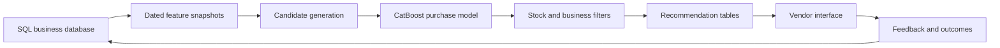

# Vendor Sales Recommendation System

## 1. Project summary

Build a recommendation system that helps each vendor answer three questions:

1. Which articles is this client most likely to need next?
2. Which clients should I contact today, and for which articles?
3. Which clients are the best prospects for a specific article?

The system will use purchase history, favorites, reorder timing, client and article characteristics, stock, and vendor feedback. The primary recommendation engine will be classical machine learning trained on the company's own transactional data. A generative language model is not required for the recommendation score.

## 2. Product goals

- Detect articles that a client normally repurchases but has not bought recently.
- Identify favorited articles with meaningful purchase intent.
- Find complementary and cross-sell articles using behavior from similar clients.
- Rank clients for each vendor by opportunity, urgency, expected value, and confidence.
- Explain every recommendation using verifiable business facts.
- Shorten the path from recommendation to contact, quotation, and order.
- Capture vendor feedback so recommendation quality improves over time.
- Measure incremental sales impact, not only prediction accuracy.

## 3. Non-goals for the first release

- Automatically contacting clients without vendor approval.
- Automatically creating or confirming orders.
- Using Gemma, Nemotron, or another language model to select articles.
- Building a deep neural recommendation model before the data volume justifies it.
- Replacing existing CRM, ERP, inventory, or vendor-assignment rules.
- Recommending unavailable, incompatible, unauthorized, or discontinued articles.

## 4. Users and core workflows

### Vendor-first workflow

The vendor opens **Clients to contact today** and sees a prioritized list. Each client card shows:

- Priority and confidence.
- One to three recommended articles.
- Suggested quantities.
- Last purchase and normal reorder interval.
- Last client contact.
- Estimated opportunity value.
- A factual reason for each recommendation.
- Actions to contact, create a quotation, snooze, or dismiss.

### Client-first workflow

From a client page, the vendor sees:

- Replenishment opportunities.
- Favorites and active interest.
- Complementary articles.
- Client-specific availability, pricing, and restrictions.
- Recent recommendations and outcomes.

### Article-first workflow

From an article page, the vendor sees clients who are most likely to need that article, subject to vendor ownership and territory permissions.

## 5. Recommendation types

### 5.1 Reorder recommendation

For articles previously purchased by the client:

- Calculate the median and average interval between purchases.
- Calculate days since the last purchase.
- Estimate purchase regularity and typical quantity.
- Calculate an overdue ratio:

`overdue_ratio = days_since_last_purchase / typical_purchase_interval`

- Fall back from client-article history to client-category or article-level patterns when history is sparse.

Example explanation:

> Usually purchased every 32 days. Last purchased 46 days ago. Typical quantity: 8.

### 5.2 Favorite recommendation

Use current favorites as an intent signal. The score should consider:

- When the favorite was added.
- Whether it was ever purchased.
- Recent views, quotations, or cart activity when available.
- Time decay so old favorites do not remain permanently important.

### 5.3 Cross-sell recommendation

Generate complementary articles from:

- Articles frequently purchased together.
- Item-to-item similarity.
- Purchasing patterns of similar clients.
- Compatible article families, categories, or substitutes.

### 5.4 Reactivation opportunity

Identify clients whose purchasing activity has fallen below their normal rhythm. Keep this separate from a product-specific reorder when there is insufficient evidence for a particular article.

## 6. Data requirements

Expected source entities:

| Entity | Important fields |
|---|---|
| Clients | Client ID, assigned vendor, segment, region, active status, creation date, contact permissions |
| Articles | Article ID, family, category, brand, active status, price, cost or margin, stock, compatibility |
| Orders | Order ID, client ID, vendor ID, order date, status |
| Order lines | Order ID, article ID, quantity, unit price, discount, returned quantity |
| Favorites | Client ID, article ID, added date, removed date or active status |
| Contacts | Vendor, client, channel, timestamp, outcome, next-contact date |
| Quotations | Client, article, quantity, price, creation date, status |
| Product mapping | Replacement SKUs, equivalent articles, bundles, incompatible products |

Cancelled orders, rejected quotations, samples, and returns must not be counted as completed purchases.

### Data-quality requirements

- Stable and unique client and article identifiers.
- Correct timestamps and order status.
- No orphan order lines.
- Normalized quantities and units.
- Duplicate-order detection.
- Fresh inventory and pricing information.
- Correct vendor-client ownership.
- Mapping for replaced or equivalent SKUs.
- Preferably 12 to 24 months of history when seasonality matters.

## 7. Proposed system architecture

The first production version can run as a daily or nightly batch process:

1. Read eligible clients, articles, transactions, favorites, and inventory.
2. Build current features.
3. Generate a manageable candidate set for each client.
4. Score candidates.
5. Apply commercial and permission filters.
6. Store ranked recommendations and deterministic explanations.
7. Expose the results to the existing vendor interface.
8. Record vendor actions and resulting orders.

## 8. Model strategy

### Candidate generation

Combine candidates from:

- Previously purchased articles that may be due again.
- Active favorites.
- Item-to-item co-purchase rules.
- Articles popular within the client's segment or preferred categories.
- Optional `implicit` ALS collaborative filtering when sufficient cross-client overlap exists.

Candidate generation must achieve high coverage before ranking quality can be improved.

### Primary model

Start with `CatBoostClassifier`, trained to estimate:

> Will this client purchase this article within the next H days?

The initial horizon `H` should be selected from the business's normal sales cycle, such as 30, 60, or 90 days. Separate horizons may be used for fast- and slow-moving categories.

One training row represents a `(snapshot_date, client_id, candidate_article_id)` combination. The label is:

- `1` when the client purchases the article within the prediction horizon.
- `0` when the eligible candidate is not purchased within the horizon.

All features must be calculated using information available before the snapshot date.

### Important features

- Days since last purchase.
- Median purchase interval and overdue ratio.
- Purchases and quantities in recent time windows.
- Typical quantity, spend, and trend.
- Purchase-interval regularity.
- Favorite status and age.
- Client category and brand affinity.
- Client recency, frequency, and monetary value.
- Article popularity and seasonality.
- Co-purchase or ALS similarity score.
- Current versus usual price and discount.
- Stock and active status.
- Previous recommendation, contact, refusal, and snooze history.

### Ranking

Keep predicted purchase probability separate from the commercial priority score:

`commercial_priority = probability * urgency * expected_value * confidence`

The exact business weights must be validated with stakeholders. A high-margin article must not automatically hide a much more likely purchase.

For the vendor's client queue, combine only the client's strongest one to three article opportunities and subtract a contact-fatigue penalty.

### Future model options

- Compare `CatBoostRanker`, `XGBRanker`, or `LightGBMRanker` when top-K ranking data is sufficient.
- Add a survival or time-to-event model if precise next-reorder timing becomes important.
- Consider a two-tower deep retrieval model only when the catalogue and interaction history become too large for the simpler pipeline.
- Optionally use text embeddings for new-article similarity when descriptions carry meaningful information.

## 9. Explanations and confidence

MVP explanations should be created from deterministic reason codes, not generated freely by a language model.

Example reason codes:

- `REORDER_OVERDUE`
- `FAVORITE_NOT_PURCHASED`
- `FREQUENTLY_BOUGHT_TOGETHER`
- `SIMILAR_CLIENTS_PURCHASED`
- `CLIENT_ACTIVITY_DECLINING`

Display factual explanations and high, medium, or low confidence. Do not display precise percentages until probability calibration has been validated.

## 10. Proposed output tables

### `article_recommendations`

| Field | Purpose |
|---|---|
| recommendation_id | Stable identifier |
| generated_at | Scoring timestamp |
| expires_at | Recommendation validity |
| vendor_id | Authorized vendor |
| client_id | Recommended client |
| article_id | Recommended article |
| recommendation_type | Reorder, favorite, cross-sell, or reactivation |
| purchase_probability | Model estimate when calibrated |
| reorder_due_score | Replenishment urgency |
| commercial_priority | Final business priority |
| expected_quantity | Suggested quantity |
| expected_value | Estimated order value |
| confidence_level | High, medium, or low |
| reason_code | Deterministic explanation code |
| model_version | Reproducibility and audit |

### `recommendation_feedback`

| Field | Purpose |
|---|---|
| recommendation_id | Related recommendation |
| vendor_id | Acting vendor |
| action | Viewed, contacted, quoted, snoozed, or dismissed |
| reason | Not needed, wrong article, too expensive, no response, and so on |
| action_at | Action timestamp |
| resulting_order_id | Linked order when applicable |

## 11. Evaluation

### Offline evaluation

Use chronological backtesting, never a random train-test split:

- Train on older periods.
- Validate on following periods.
- Test on the most recent untouched period.

Track:

- Candidate Recall@100.
- Precision, Recall, Hit Rate, and NDCG at the displayed recommendation count.
- Reorder recommendation recall.
- Client and catalogue coverage.
- Probability calibration.
- Revenue and margin represented in the top recommendations.
- Results for new, sparse, and established clients separately.

### Business evaluation

- Vendor usage and dismissal rate.
- Contact-to-quotation and quotation-to-order conversion.
- Incremental orders, revenue, and margin.
- Time saved per vendor.
- Time from recommendation to order.
- Returns, complaints, excessive discounts, and unwanted-contact rate.

Use a controlled pilot where possible. A purchase that would have happened without vendor action should not be credited entirely to the recommender.

## 12. Security and guardrails

- Vendors may only see their authorized clients and territories.
- Respect communication opt-outs and contact-frequency limits.
- Do not expose another client's identity or behavior in explanations.
- Keep an audit trail of recommendations, model versions, and actions.
- Do not recommend clients on credit hold unless business policy permits it.
- Never bypass stock, contract, compatibility, or client-specific pricing rules.
- Keep a human vendor in control of contacts, quotations, and orders.

## 13. Optional language-model role

Gemma, Nemotron, or another language model may later support:

- A conversational vendor assistant.
- Summaries of client history.
- Draft sales messages.
- Rewriting already-verified reason facts in natural language.

The language model must not be the source of recommendation scores, product availability, prices, or eligibility decisions.

## 14. Open decisions

- SQL engine and existing application technology.
- Number of clients, articles, completed order lines, and years of history.
- Whether articles are consumables, spare parts, equipment, or a mixture.
- Normal reorder horizons by article category.
- Definition and lifecycle of a favorite.
- Availability of quotations, contacts, refusals, and vendor feedback.
- Client-specific catalogues, contracts, prices, and compatibility constraints.
- Primary business objective: conversion, revenue, margin, retention, or vendor time saved.
- Batch frequency and freshness requirements.

